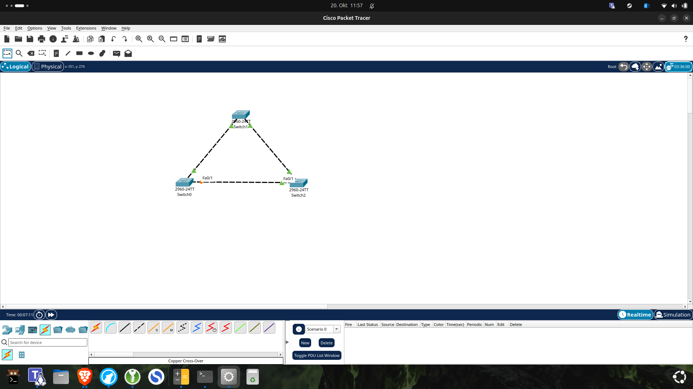
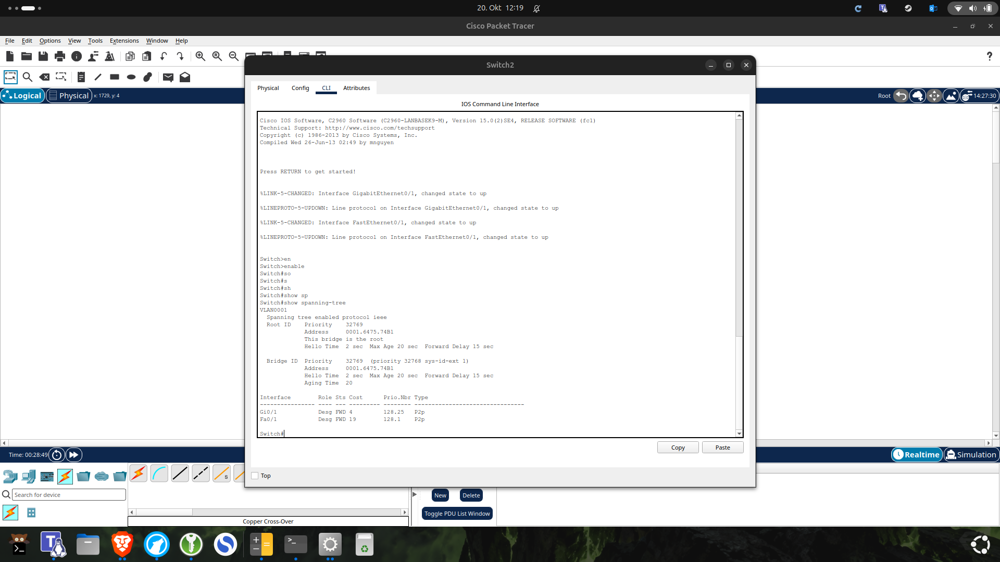
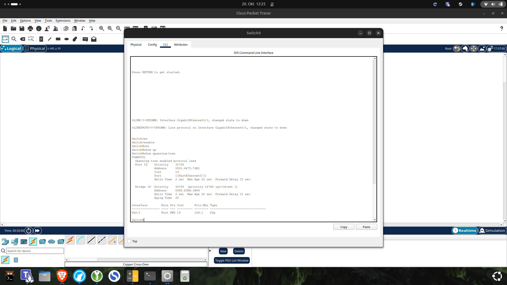
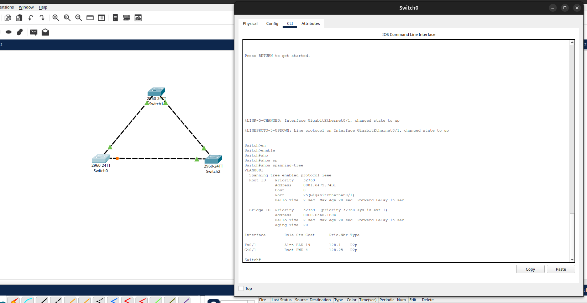

# Lab 05 — STP Redundancy and Failover

## 1. Lab Overview

This lab demonstrates how **Spanning Tree Protocol (STP)** prevents Layer 2 switching loops while maintaining redundant connections between switches.

We build a triangular topology using three Cisco Catalyst 2960 switches, observe automatic Root Bridge election, identify forwarding and blocking ports, and simulate a network link failure.

After the failure, we verify that STP activates an alternative forwarding path. Finally, we restore the original link and observe how the network returns to its preferred topology.

### Learning Objectives

By completing this lab, we learn how to:

- Build a redundant Layer 2 network.
- Understand why switching loops are dangerous.
- Identify the STP Root Bridge.
- Understand Root, Designated, and Alternate Ports.
- Interpret STP port roles and states.
- Understand STP path costs.
- Use Cisco IOS commands to verify STP.
- Simulate and troubleshoot a failed link.
- Observe STP convergence and recovery.

---

## 2. Theory — Spanning Tree Protocol

### What Is STP?

**STP (Spanning Tree Protocol)** is a Layer 2 protocol originally standardized as IEEE 802.1D.

STP prevents switching loops when multiple physical connections exist between switches.

Redundant connections are useful because they provide alternative paths if a cable or interface fails.

However, without a loop-prevention mechanism, redundant Ethernet paths can create serious problems.

### Layer 2 Switching Loops

Consider three switches connected in a triangle.

If a broadcast frame enters this topology without STP, switches can repeatedly forward copies of the frame around the loop.

Unlike an IPv4 packet, an Ethernet frame does not contain a Time to Live (TTL) field that decreases at every switch.

Possible consequences include:

- **Broadcast storms:** Repeated broadcasts consume network bandwidth.
- **MAC address table instability:** The same MAC address may appear on different ports.
- **Duplicate frames:** Devices may receive multiple copies of traffic.
- **Network congestion:** Excessive switching traffic reduces performance.
- **Network outages:** The network may become unusable.

STP prevents these problems by creating a **loop-free logical forwarding topology**.

Some redundant ports are placed into a non-forwarding state while their physical connections remain available.

If an active link fails, STP can activate a backup path.

### Root Bridge Election

STP selects one switch as the **Root Bridge** for the spanning-tree instance.

The Root Bridge acts as the reference point for calculating the best paths through the network.

STP compares the **Bridge ID (BID)**, which includes bridge priority and MAC address information.

The switch with the lowest Bridge ID wins.

Selection rules:

1. Lowest bridge priority.
2. If priorities are equal, lowest MAC address.

On Cisco switches using an extended system ID, the displayed priority also includes the VLAN identifier.

For example, the default priority for VLAN 1 is commonly displayed as:

```text
32769 = 32768 + VLAN ID 1
```

The Root Bridge has no Root Port.

Its participating ports are Designated Ports.

### STP Port Roles

| Port Role | Description |
|---|---|
| Root Port | Best path from a non-root switch toward the Root Bridge |
| Designated Port | Selected forwarding port for a network segment |
| Alternate Port | Backup path that does not normally forward user traffic |

**Note:** The Alternate Port role is associated with Rapid STP terminology. Cisco's implementation may display `Altn` even when the output identifies the spanning-tree protocol as `ieee`.

### STP Port States

Classic IEEE 802.1D STP uses five port states.

| State | Description |
|---|---|
| Disabled | Port does not participate in STP |
| Blocking | Does not forward normal traffic or learn MAC addresses |
| Listening | Processes STP information but does not learn MAC addresses |
| Learning | Learns MAC addresses but does not forward user traffic |
| Forwarding | Learns MAC addresses and forwards user traffic |

Common Cisco IOS abbreviations:

| Abbreviation | Meaning |
|---|---|
| FWD | Forwarding |
| BLK | Blocking |
| LIS | Listening |
| LRN | Learning |
| Desg | Designated |
| Root | Root Port |
| Altn | Alternate Port |

Rapid STP (RSTP, IEEE 802.1w) simplifies the port states and supports faster convergence.

### Bridge Protocol Data Units

**BPDU** stands for **Bridge Protocol Data Unit**.

Switches exchange BPDUs to communicate information about the STP topology.

Important information includes:

- Root Bridge ID
- Sending Bridge ID
- Root Path Cost
- Port ID

BPDUs help switches determine the Root Bridge and select loop-free paths.

---

## 3. Lab Requirements and Topology

### Devices

- 3 × Cisco Catalyst 2960-24TT switches
- 3 × Copper Cross-Over cables
- Cisco Packet Tracer

No PCs or routers are required to demonstrate the STP control-plane behavior in this lab.

### Topology

```text
                  Switch1
                   /   \
                  /     \
                 /       \
                /         \
           Switch0 ------- Switch2
```

The three physical connections form a triangle, creating redundant Layer 2 paths.

### Our Packet Tracer Topology



*Figure 1: Three Cisco switches connected in a triangle. The orange indicator on Switch0 Fa0/1 shows a non-forwarding port after STP convergence.*

### Interface Connections

| Link | Device A | Interface | Device B | Interface |
|---|---|---|---|---|
| 1 | Switch1 | Gi0/1 | Switch0 | Gi0/1 |
| 2 | Switch1 | Gi0/2 | Switch2 | Gi0/1 |
| 3 | Switch0 | Fa0/1 | Switch2 | Fa0/1 |

All switches initially use the default VLAN 1.

We do not manually configure the Root Bridge during the first part of the lab.

Instead, we observe the automatic election process.

---

## 4. Build the Network

Open Cisco Packet Tracer.

1. Create a new Packet Tracer project.
2. Select **Network Devices → Switches**.
3. Add three Cisco 2960-24TT switches.
4. Arrange the switches in a triangle.
5. Open **Connections**.
6. Select **Copper Cross-Over**.
7. Connect the interfaces according to the connection table.
8. Wait for STP to converge.

### Expected Behavior

Initially, some interfaces may display amber or orange indicators while STP calculates the topology.

After convergence, one redundant path should have a non-forwarding port.

The exact blocked port depends on the elected Root Bridge, path costs, and STP tie-breaking rules.

In our lab, Switch0 Fa0/1 became the blocked port.

We verified this behavior using the CLI.

---

## 5. Verify STP on Switch0

Open **Switch0 → CLI**.

Enter privileged EXEC mode:

```cisco
enable
```

Display STP information:

```cisco
show spanning-tree
```

### Observed Output

```text
VLAN0001
  Spanning tree enabled protocol ieee

  Root ID    Priority    32769
             Address     0001.6475.7431
             Cost        4
             Port        25 (GigabitEthernet0/1)
```

The interface table showed:

```text
Interface  Role  Sts  Cost
Fa0/1      Altn  BLK  19
Gi0/1      Root  FWD  4
```

### Explanation

**GigabitEthernet0/1**

- Root Port
- Forwarding state
- Interface STP cost: 4
- Preferred path toward the Root Bridge

**FastEthernet0/1**

- Alternate Port
- Blocking state
- Interface STP cost: 19
- Provides a backup connection

This confirms that STP prevents a Layer 2 loop by blocking normal forwarding on Fa0/1.

**Important distinction:** The `Cost` column in the interface table shows the cost associated with that interface. The `Root ID Cost` value represents the total calculated cost toward the Root Bridge.

An early Switch0 screenshot displayed a root path cost of 4. After the topology had fully converged, the expected stable path through two GigabitEthernet links had a total cost of 8, as confirmed during the restoration test.

---

## 6. Identify the Root Bridge

We inspected all three switches using:

```cisco
show spanning-tree
```

### Switch0

Switch0 reported the following Root Bridge:

```text
Root ID
  Priority 32769
  Address  0001.6475.7431
```

Its own Bridge ID was different from the Root ID.

Therefore, Switch0 was not the Root Bridge.

### Switch1

Switch1 also reported:

```text
Root ID
  Priority 32769
  Address  0001.6475.7431
  Cost     4
  Port     26 (GigabitEthernet0/2)
```

Its interface table showed:

```text
Gi0/2   Root   FWD
Gi0/1   Desg   FWD
```

Switch1 had a Root Port, so it was not the Root Bridge.

### Switch2

Switch2 displayed:

```text
This bridge is the root
```

Its Root ID and Bridge ID matched:

```text
0001.6475.7431
```



*Figure 2: Switch2 identifies itself as the Root Bridge for VLAN 1.*

### Result

**Switch2 was elected the Root Bridge.**

Its interfaces were:

```text
Gi0/1   Desg   FWD
Fa0/1   Desg   FWD
```

This is expected because the Root Bridge has no Root Port.

---

## 7. Initial STP Port Roles

After convergence, the topology had the following port roles.

| Switch | Interface | Role | State |
|---|---|---|---|
| Switch0 | Gi0/1 | Root | Forwarding |
| Switch0 | Fa0/1 | Alternate | Blocking |
| Switch1 | Gi0/2 | Root | Forwarding |
| Switch1 | Gi0/1 | Designated | Forwarding |
| Switch2 | Gi0/1 | Designated | Forwarding |
| Switch2 | Fa0/1 | Designated | Forwarding |

### Logical Forwarding Topology

```text
           Switch0
              |
              | Gi0/1
              |
           Switch1
              |
              | Gi0/2
              |
           Switch2
         (Root Bridge)
```

Switch0 also had a direct physical connection to Switch2.

However, Switch0 Fa0/1 was blocked.

That direct connection remained available as a backup path.

---

## 8. Understanding STP Path Costs

STP calculates the best path toward the Root Bridge using path costs.

Lower total cost is preferred.

Traditional short STP path costs include:

| Ethernet Speed | STP Cost |
|---|---:|
| 10 Mbps | 100 |
| 100 Mbps | 19 |
| 1 Gbps | 4 |
| 10 Gbps | 2 |

Different cost methods may produce different values on modern equipment.

### Our Normal Path

Switch0 reached the Root Bridge using:

```text
Switch0 → Switch1 → Switch2
```

This path used two GigabitEthernet links.

The total cost was:

```text
4 + 4 = 8
```

The direct connection from Switch0 to Switch2 used FastEthernet:

```text
Switch0 → Switch2
```

Its path cost was:

```text
19
```

STP preferred the lower-cost path:

```text
8 < 19
```

This explains why the GigabitEthernet route remained active while the FastEthernet connection was blocked on Switch0.

---

## 9. Simulate an Active Link Failure

Next, we tested whether STP could restore connectivity through the backup path.

We deliberately disabled the connection between Switch1 and Switch0.

### Configuration on Switch1

Open **Switch1 → CLI**.

```cisco
enable
configure terminal
interface gigabitEthernet 0/1
shutdown
end
```

### Explanation

The command:

```cisco
shutdown
```

administratively disables the selected interface.

In our topology:

```text
Switch1 Gi0/1 ↔ Switch0 Gi0/1
```

Disabling this connection removes Switch0's original forwarding path through Switch1.

STP must then calculate another path to the Root Bridge.

### Expected Behavior

The backup connection between Switch0 and Switch2 should become active.

Wait for STP to reconverge before checking the results.

Classic STP may require tens of seconds for some topology changes.

---

## 10. Verify Automatic STP Failover

After disabling the original link, we checked Switch0.

```cisco
show spanning-tree
```

### Observed Output

```text
Root ID
  Priority 32769
  Address  0001.6475.7431
  Cost     19
  Port     1 (FastEthernet0/1)
```

The interface table showed:

```text
Interface  Role  Sts  Cost
Fa0/1      Root  FWD  19
```



*Figure 3: After the original link fails, Switch0 Fa0/1 changes from Alternate/Blocking to Root/Forwarding.*

### What Changed?

Before the failure:

```text
Fa0/1 → Altn BLK
```

After the failure:

```text
Fa0/1 → Root FWD
```

Switch0 now reached Switch2 directly through FastEthernet0/1.

### New Forwarding Path

```text
Switch0
   |
   | FastEthernet0/1
   |
Switch2
(Root Bridge)
```

The Root Path Cost increased from 8 to 19 because the alternative link was slower.

**Result:** STP successfully activated the redundant connection and restored an available path toward the Root Bridge.

---

## 11. Restore the Original Connection

After verifying failover, we restored the disabled GigabitEthernet link.

### Configuration on Switch1

```cisco
enable
configure terminal
interface gigabitEthernet 0/1
no shutdown
end
```

### Explanation

```cisco
no shutdown
```

removes the administrative shutdown from the interface.

The physical connection becomes available again.

STP recalculates the topology and selects the preferred forwarding path.

We waited for STP to converge before checking the switch again.

---

## 12. Verify STP Recovery

On Switch0:

```cisco
show spanning-tree
```

### Observed Output

```text
Root ID
  Priority 32769
  Address  0001.6475.7431
  Cost     8
  Port     25 (GigabitEthernet0/1)
```

The interface roles returned to:

```text
Interface  Role  Sts  Cost
Fa0/1      Altn  BLK  19
Gi0/1      Root  FWD  4
```



*Figure 4: After restoring the GigabitEthernet connection, Switch0 selects Gi0/1 as its Root Port and blocks Fa0/1 again.*

### Explanation

Switch0 once again selected the path through Switch1:

```text
Switch0 → Switch1 → Switch2
```

The total Root Path Cost returned to 8.

The direct FastEthernet connection returned to Alternate/Blocking.

**Result:** STP restored the original loop-free forwarding topology.

---

## 13. Before and After Comparison

| Property | Normal Operation | Link Failure | Link Restored |
|---|---|---|---|
| Root Bridge | Switch2 | Switch2 | Switch2 |
| Switch0 Gi0/1 | Root, FWD | Down | Root, FWD |
| Switch0 Fa0/1 | Altn, BLK | Root, FWD | Altn, BLK |
| Root Path Cost | 8 | 19 | 8 |
| Preferred Path | Via Switch1 | Direct to Switch2 | Via Switch1 |

### Main Observation

STP maintained a loop-free topology during all three stages.

The protocol also automatically adjusted the active forwarding path when the network topology changed.

---

## 14. Important Cisco IOS Commands

| Command | Purpose |
|---|---|
| `enable` | Enter privileged EXEC mode |
| `show spanning-tree` | Display STP information |
| `configure terminal` | Enter global configuration mode |
| `interface gigabitEthernet 0/1` | Select a GigabitEthernet interface |
| `shutdown` | Administratively disable an interface |
| `no shutdown` | Administratively enable an interface |
| `end` | Return to privileged EXEC mode |
| `show interfaces status` | Display interface status on supported Cisco switches |
| `copy running-config startup-config` | Save the current configuration |

### Useful Verification Command

```cisco
show spanning-tree
```

This displays:

- Root Bridge information
- Local Bridge ID
- Root Path Cost
- Root Port
- STP timers
- Interface roles
- Interface states
- Interface path costs

---

## 15. Troubleshooting Lessons

### Lesson 1 — Verify STP with CLI Commands

An orange interface indicator in Packet Tracer may indicate a non-forwarding STP port.

However, color alone does not prove why an interface is in that state.

Always verify with:

```cisco
show spanning-tree
```

### Lesson 2 — Identify the Correct Interface

Before changing any switch interface, confirm which physical cable is connected to it.

In this lab, we disabled:

```text
Switch1 Gi0/1
```

That interface connects to:

```text
Switch0 Gi0/1
```

Disabling a different interface would affect a different network path.

### Lesson 3 — Compare Root Path Costs

The interface cost and the total Root Path Cost are related but different values.

For example:

```text
Gi0/1 interface cost = 4
Total Root Path Cost = 8
```

The Root Path Cost includes the costs along the complete selected path toward the Root Bridge.

### Lesson 4 — Understand Blocking

A blocked STP port is not necessarily faulty.

It may be intentionally prevented from forwarding user traffic to avoid a Layer 2 loop.

The connection can still serve as a backup.

---

## 16. Save the Configuration

After completing the tests, verify that the original network connections are restored.

On each switch, save the active configuration:

```cisco
copy running-config startup-config
```

Expected confirmation:

```text
Building configuration...
[OK]
```

Save the Packet Tracer project using:

```text
05-stp-redundancy-failover.pkt
```

### Note

Saving the configuration and saving the Packet Tracer project are separate operations.

`copy running-config startup-config` saves the device configuration within Cisco IOS.

Saving the `.pkt` file preserves the Packet Tracer project.

---

## 17. Final Results

This lab demonstrated:

- A redundant three-switch Layer 2 topology
- Automatic STP Root Bridge election
- Switch2 elected as the Root Bridge for VLAN 1
- Identification of Root, Designated, and Alternate Ports
- STP blocking a redundant forwarding path
- Verification using `show spanning-tree`
- Successful path failover after an active link was disabled
- Automatic restoration of the preferred path after the link was re-enabled

### What I Learned

This lab helped me understand that redundant connections are useful but must be controlled to avoid Layer 2 loops.

I learned how to read STP output, identify the Root Bridge, and understand why certain interfaces are forwarding or blocking.

The most important part was observing the failover process.

When we disabled the active GigabitEthernet connection, STP activated the previously blocked FastEthernet path.

After restoring the original connection, STP automatically returned to the lower-cost forwarding path.

This showed how STP combines **loop prevention and network redundancy**.

---

## 18. Lab Files

- [Open the Packet Tracer Lab](05-stp-redundancy-failover.pkt)
- [Return to CCNA Learning](../../README.md)