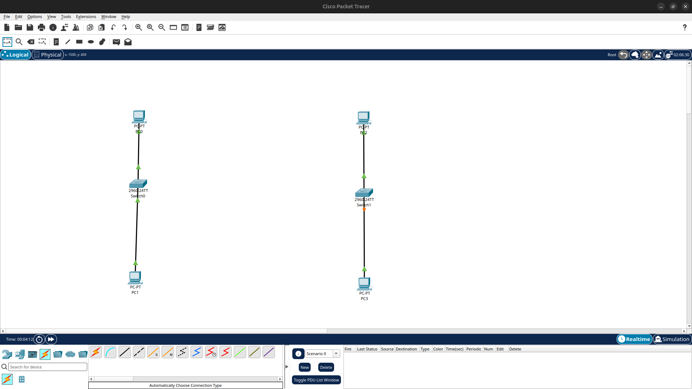
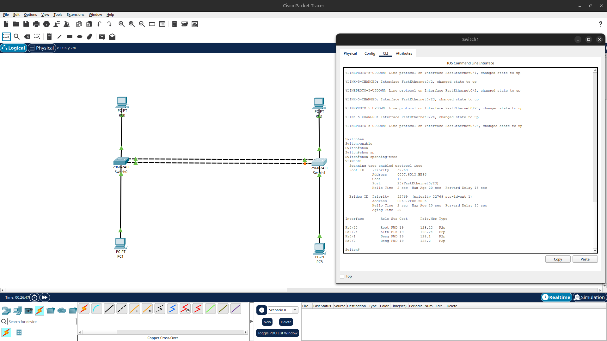
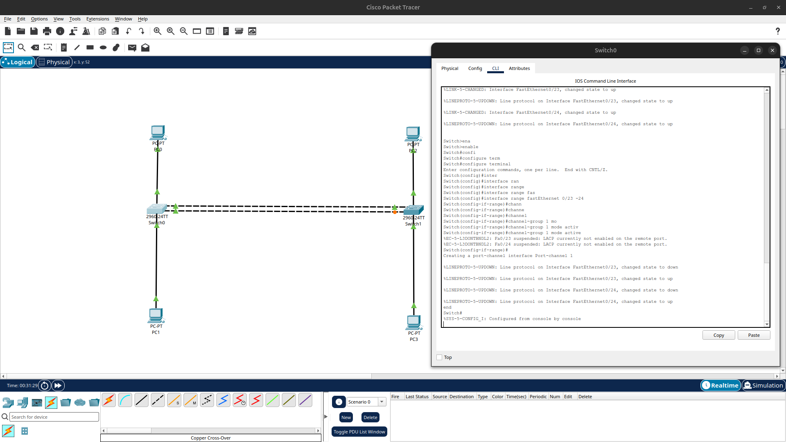
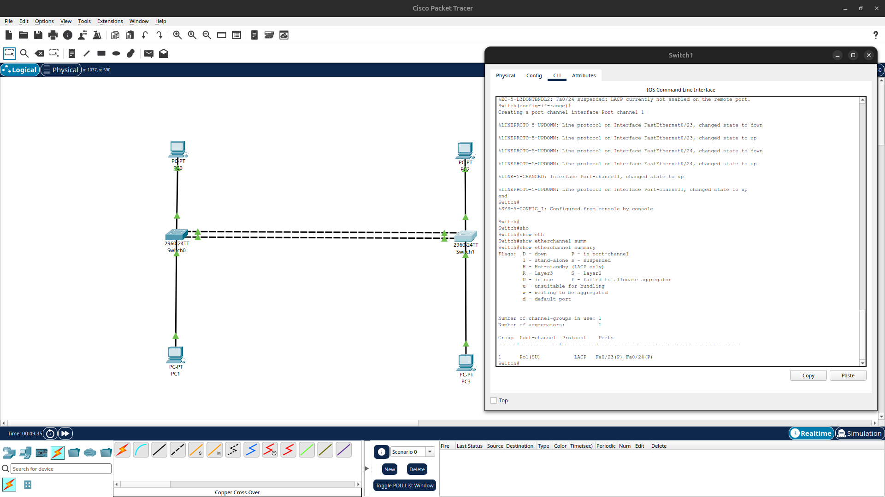
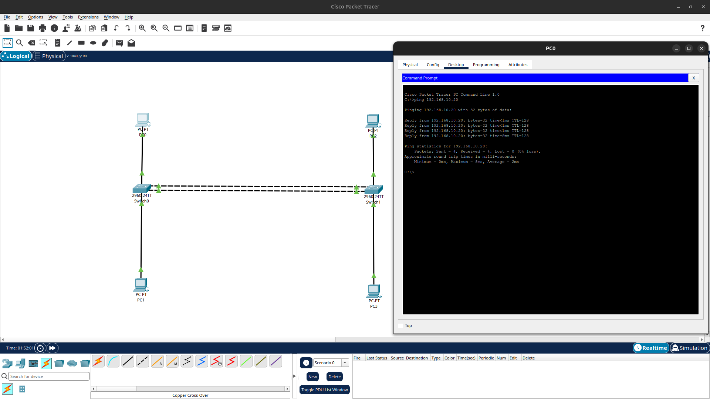
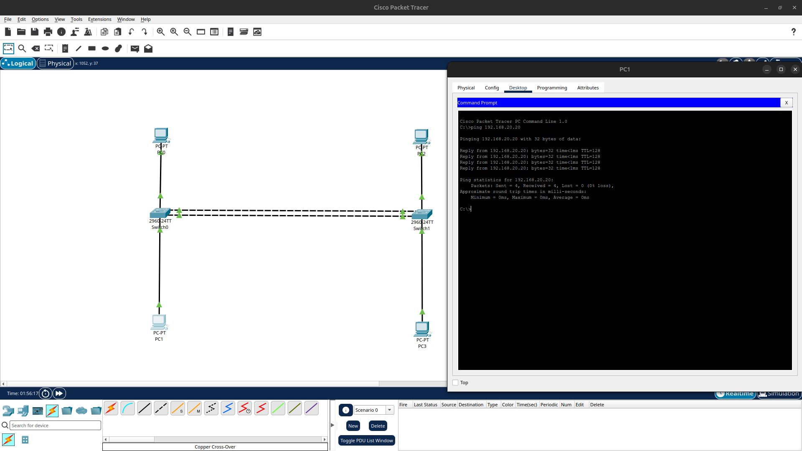
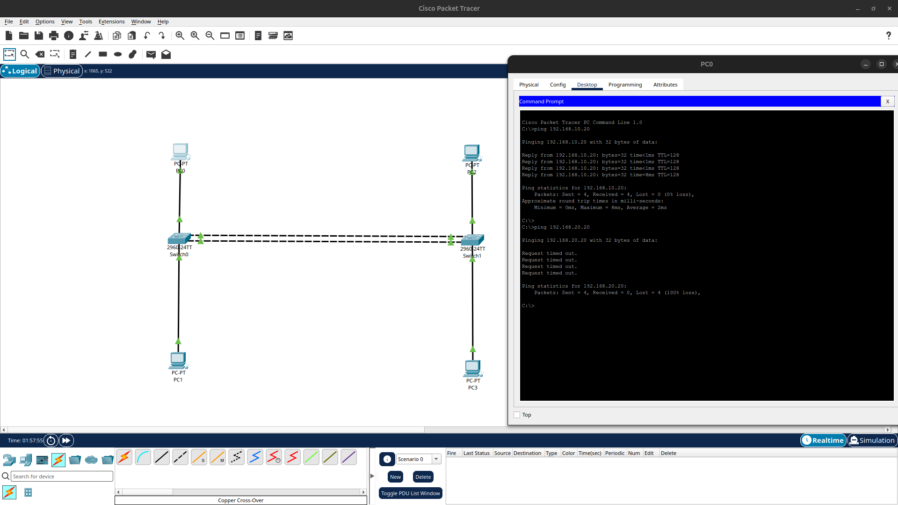
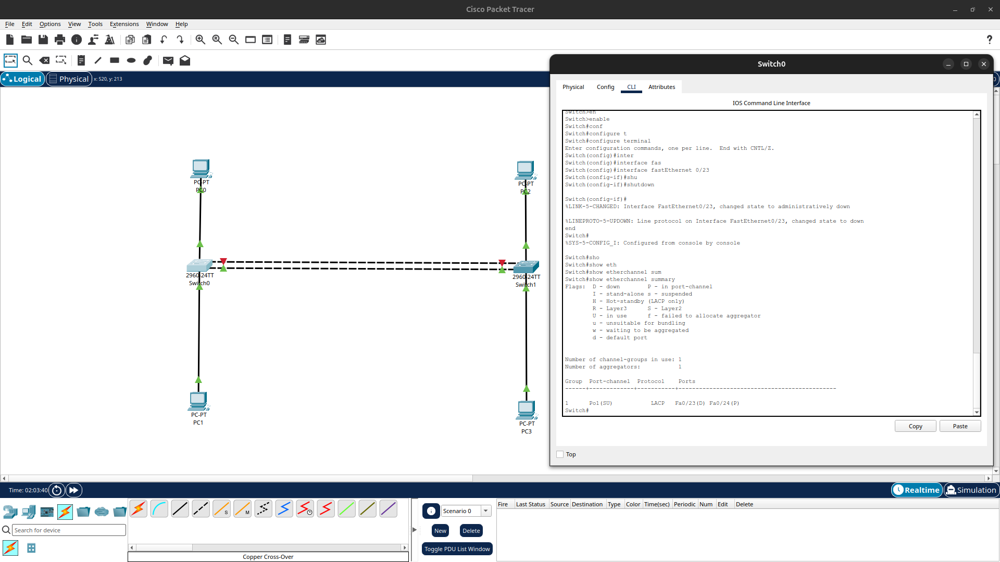
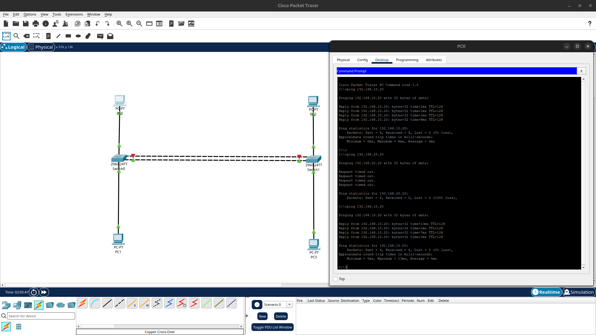
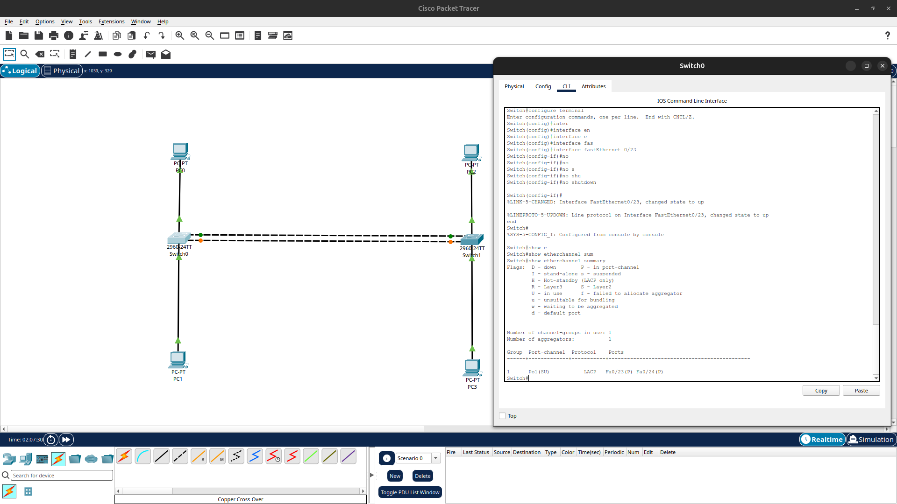

# Lab 06 — LACP EtherChannel

**Course:** Cisco CCNA 200-301  
**Tool:** Cisco Packet Tracer  
**Devices:** 2 × Cisco 2960-24TT switches, 4 × PCs  
**Topics:** EtherChannel, LACP, VLANs, Trunking, STP, Link Redundancy

---

## 1. Introduction

In this lab, I configured an EtherChannel between two Cisco switches using **LACP (Link Aggregation Control Protocol)**.

The goal was to combine two physical Ethernet connections into one logical interface, verify that both links could carry traffic, and demonstrate what happens when one physical connection fails.

I also configured two separate VLANs, connected four PCs, and tested communication across the switches.

The most important part of the lab was verifying that **the network continued working even after one EtherChannel member link was disabled**.

### Learning Objectives

- Understand why EtherChannel is used in switched networks.
- Configure LACP between two Cisco switches.
- Understand the difference between physical interfaces and Port-channels.
- Observe how EtherChannel interacts with Spanning Tree Protocol.
- Configure VLANs and an IEEE 802.1Q trunk.
- Verify EtherChannel using Cisco IOS commands.
- Test network connectivity and VLAN isolation.
- Simulate and recover from a physical link failure.

---

## 2. Theory — What Is EtherChannel?

EtherChannel is a technology that combines multiple physical Ethernet interfaces into a single logical connection called a **Port-channel**.

For example:

```text
              Link 1 — Fa0/23
Switch0 ========================== Switch1
Switch0 ========================== Switch1
              Link 2 — Fa0/24

            Logical Port-channel1
```

Normally, connecting two switches with multiple independent Layer 2 links can create a switching loop.

**STP (Spanning Tree Protocol)** prevents these loops by placing redundant paths into a non-forwarding state.

However, this also means some physical links cannot be used for normal traffic.

EtherChannel solves this problem by grouping compatible physical connections into one logical interface.

STP then treats the entire EtherChannel as one logical connection rather than blocking individual members.

### Main Benefits

**1. Increased aggregate bandwidth**

Multiple physical interfaces can share traffic.

For example, two 100-Mbps FastEthernet links provide up to 200 Mbps of aggregate link capacity.

However, an individual traffic flow does not automatically achieve 200 Mbps. EtherChannel typically uses hashing to select one physical member for a given flow.

**2. Redundancy**

If one physical link fails, the Port-channel can continue operating through the remaining members.

**3. Better link utilization**

Both physical interfaces can participate in forwarding traffic instead of one being blocked by STP.

**4. Simplified configuration**

Shared Layer 2 settings can be configured on the logical Port-channel interface.

---

## 3. What Is LACP?

**LACP (Link Aggregation Control Protocol)** is a standards-based protocol used to negotiate and maintain link aggregation.

It was originally standardized under IEEE 802.3ad and is now covered by IEEE 802.1AX.

LACP allows two connected devices to exchange control information and determine which interfaces can form an EtherChannel.

### LACP Negotiation Modes

| Mode | Description |
|---|---|
| Active | Initiates LACP negotiation |
| Passive | Responds to LACP negotiation |

Valid combinations:

| Switch0 | Switch1 | Result |
|---|---|---|
| Active | Active | EtherChannel forms |
| Active | Passive | EtherChannel forms |
| Passive | Active | EtherChannel forms |
| Passive | Passive | No EtherChannel negotiation |

At least one side must use Active mode.

### LACP vs. PAgP

**PAgP (Port Aggregation Protocol)** is Cisco's proprietary EtherChannel negotiation protocol.

PAgP uses the modes `desirable` and `auto`, whereas LACP uses `active` and `passive`.

| Technology | Initiating Mode | Responding Mode |
|---|---|---|
| LACP | Active | Passive |
| PAgP | Desirable | Auto |

Both ends must use a compatible negotiation protocol.

In this lab, I configured **LACP Active on both switches**.

---

## 4. Network Topology

### Required Devices

- 2 × Cisco Catalyst 2960-24TT
- 4 × PC-PT
- 2 × Copper Cross-Over cables between switches
- 4 × Copper Straight-Through cables for the PCs

### Physical Connections

```text
       PC0                                  PC2
        |                                    |
       Fa0/1                                Fa0/1
        |                                    |
     Switch0 ===== Fa0/23 ↔ Fa0/23 ===== Switch1
     Switch0 ===== Fa0/24 ↔ Fa0/24 ===== Switch1
        |                                    |
       Fa0/2                                Fa0/2
        |                                    |
       PC1                                  PC3
```

The two parallel switch-to-switch links will form **Port-channel1**.

### Packet Tracer Topology



*Figure 1: Two switches connected to four PCs. Two physical links provide the connections used for EtherChannel.*

### Interface Assignment

| Device | Interface | Connected To |
|---|---|---|
| Switch0 | Fa0/1 | PC0 |
| Switch0 | Fa0/2 | PC1 |
| Switch0 | Fa0/23 | Switch1 Fa0/23 |
| Switch0 | Fa0/24 | Switch1 Fa0/24 |
| Switch1 | Fa0/1 | PC2 |
| Switch1 | Fa0/2 | PC3 |
| Switch1 | Fa0/23 | Switch0 Fa0/23 |
| Switch1 | Fa0/24 | Switch0 Fa0/24 |

---

## 5. Observe STP Before EtherChannel

Before configuring LACP, the two switch-to-switch connections were independent Layer 2 links.

On Switch1, I entered:

```cisco
enable
show spanning-tree
```

### Observed Result

```text
Interface    Role    Sts    Cost
Fa0/23       Root    FWD    19
Fa0/24       Altn    BLK    19
```



*Figure 2: STP blocks one redundant physical link to prevent a switching loop.*

### Explanation

`Fa0/23` was the Root Port and forwarded traffic toward the Root Bridge.

`Fa0/24` was an Alternate Port in the Blocking state.

This meant that although two physical links were connected, STP prevented one from forwarding normal traffic.

The Root Bridge for VLAN 1 was Switch0.

This provides our baseline for comparing the network before and after EtherChannel configuration.

---

## 6. Configure LACP EtherChannel

Next, I configured the two physical interfaces on each switch to participate in Channel Group 1.

### Switch0 Configuration

```cisco
enable
configure terminal

interface range fastEthernet 0/23 - 24
 channel-group 1 mode active

end
```

### Explanation

`interface range fastEthernet 0/23 - 24` selects both physical interfaces simultaneously.

`channel-group 1 mode active` places the interfaces into LACP Channel Group 1.

Cisco IOS creates a corresponding logical interface:

```text
Port-channel1
```

### Initial LACP Negotiation

During the first configuration, Switch0 displayed messages similar to:

```text
Fa0/23 suspended: LACP currently not enabled on the remote port.
Fa0/24 suspended: LACP currently not enabled on the remote port.
```



*Figure 3: Switch0 initially cannot negotiate LACP because the other switch has not been configured yet.*

These messages were expected at this stage.

LACP was active on Switch0, but Switch1 had not yet been configured to participate in the same aggregation.

### Switch1 Configuration

```cisco
enable
configure terminal

interface range fastEthernet 0/23 - 24
 channel-group 1 mode active

end
```

After both switches were configured with LACP Active mode, the EtherChannel successfully formed.

---

## 7. Verify EtherChannel

On Switch1:

```cisco
show etherchannel summary
```

### Observed Output

```text
Group  Port-channel  Protocol  Ports
1      Po1(SU)       LACP      Fa0/23(P) Fa0/24(P)
```



*Figure 4: Both physical interfaces are successfully bundled into Port-channel1.*

### Understanding the Output

| Indicator | Meaning |
|---|---|
| Po1 | Port-channel1 |
| S | Layer 2 EtherChannel |
| U | Port-channel is in use |
| LACP | Link Aggregation Control Protocol |
| P | Physical interface successfully bundled |

The important result is:

```text
Po1(SU)    Fa0/23(P) Fa0/24(P)
```

This confirms that the logical EtherChannel is operational and both physical interfaces participate in the bundle.

### STP After EtherChannel

I also verified the STP state again:

```cisco
show spanning-tree
```

Before EtherChannel, STP displayed two separate physical interfaces.

After EtherChannel, STP recognized the logical connection:

```text
Interface    Role    Sts    Cost
Po1          Root    FWD    12
```

The root path cost changed from 19 to 12 in our Packet Tracer simulation.

**Why?**

EtherChannel changes how the bundled connection is represented to STP. The simulated switch assigned the aggregated connection a lower STP cost than the individual FastEthernet link.

STP still provides loop prevention, but it now operates on Port-channel1 as one logical interface.

---

## 8. Create VLAN 10 and VLAN 20

The next goal was to carry traffic from two departments across the EtherChannel.

I created two VLANs on both switches.

**VLAN (Virtual Local Area Network)** separates a switched network into distinct Layer 2 broadcast domains.

### VLAN Plan

| VLAN ID | Name | Department |
|---|---|---|
| 10 | IT | Information Technology |
| 20 | HR | Human Resources |

### Configuration on Both Switches

Enter the following commands on Switch0 and repeat them on Switch1:

```cisco
enable
configure terminal

vlan 10
 name IT
exit

vlan 20
 name HR
exit

end
```

### Verification

```cisco
show vlan brief
```

Expected entries:

```text
10   IT   active
20   HR   active
```

Both VLANs were successfully created on both switches.

---

## 9. Configure PC Access Ports

Each PC must be assigned to the correct VLAN.

An **access port** normally connects an end device to one VLAN.

### VLAN Assignment

| PC | Switch | Interface | VLAN |
|---|---|---|---|
| PC0 | Switch0 | Fa0/1 | 10 — IT |
| PC1 | Switch0 | Fa0/2 | 20 — HR |
| PC2 | Switch1 | Fa0/1 | 10 — IT |
| PC3 | Switch1 | Fa0/2 | 20 — HR |

### Switch0 Configuration

```cisco
enable
configure terminal

interface fastEthernet 0/1
 switchport mode access
 switchport access vlan 10
exit

interface fastEthernet 0/2
 switchport mode access
 switchport access vlan 20
exit

end
```

### Switch1 Configuration

```cisco
enable
configure terminal

interface fastEthernet 0/1
 switchport mode access
 switchport access vlan 10
exit

interface fastEthernet 0/2
 switchport mode access
 switchport access vlan 20
exit

end
```

### Explanation

`switchport mode access` sets the interface to access mode.

`switchport access vlan 10` assigns the port to VLAN 10.

`switchport access vlan 20` assigns the port to VLAN 20.

Verify with:

```cisco
show vlan brief
```

Both switches should show Fa0/1 in VLAN 10 and Fa0/2 in VLAN 20.

---

## 10. Configure Port-channel1 as a Trunk

Now we need to transport traffic from both VLANs between the switches.

A **trunk** is a switch connection that can carry traffic belonging to multiple VLANs.

IEEE 802.1Q identifies VLANs by adding VLAN tagging information to Ethernet frames, except for traffic sent untagged on the native VLAN under normal trunk behavior.

Since our physical interfaces are bundled, we configure the logical Port-channel.

### Configuration on Both Switches

```cisco
enable
configure terminal

interface port-channel 1
 switchport mode trunk
 switchport trunk allowed vlan 10,20

end
```

### Explanation

`interface port-channel 1` selects the logical EtherChannel interface.

`switchport mode trunk` configures the interface as a trunk.

`switchport trunk allowed vlan 10,20` restricts the allowed VLAN list to VLANs 10 and 20.

The native VLAN remains VLAN 1 in this lab.

Member interfaces must maintain compatible settings. Cisco IOS normally coordinates supported configuration changes between the logical Port-channel and its member interfaces.

### Verification

```cisco
show interfaces trunk
show etherchannel summary
```

The important output is:

```text
Port    Mode    Encapsulation    Status      Native vlan
Po1     on      802.1q           trunking    1

Port    Vlans allowed on trunk
Po1     10,20
```

Both switches successfully displayed Port-channel1 operating as a trunk with VLANs 10 and 20 allowed.

The EtherChannel summary continued showing:

```text
Po1(SU)    LACP    Fa0/23(P) Fa0/24(P)
```

This confirms that trunking was configured while the EtherChannel remained operational.

---

## 11. Configure IPv4 Addresses

All four PCs were configured manually using:

**PC → Desktop → IP Configuration → Static**

### Addressing Table

| PC | VLAN | IPv4 Address | Subnet Mask |
|---|---|---|---|
| PC0 | 10 | 192.168.10.10 | 255.255.255.0 |
| PC2 | 10 | 192.168.10.20 | 255.255.255.0 |
| PC1 | 20 | 192.168.20.10 | 255.255.255.0 |
| PC3 | 20 | 192.168.20.20 | 255.255.255.0 |

### Subnets

VLAN 10:

```text
192.168.10.0/24
```

VLAN 20:

```text
192.168.20.0/24
```

No default gateway was configured because this lab does not include a router or Layer 3 inter-VLAN routing.

Our goal was to test communication within each VLAN across the Layer 2 EtherChannel.

---

## 12. Test VLAN 10 Connectivity

From PC0:

**Desktop → Command Prompt**

```text
ping 192.168.10.20
```

### Observed Result

```text
Reply from 192.168.10.20
Reply from 192.168.10.20
Reply from 192.168.10.20
Reply from 192.168.10.20

Packets: Sent = 4, Received = 4, Lost = 0 (0% loss)
```



*Figure 5: PC0 successfully communicates with PC2 across the EtherChannel.*

### Explanation

PC0 and PC2 belong to VLAN 10 and the same IPv4 subnet.

Although they are connected to different physical switches, the trunk carries their VLAN traffic across the EtherChannel.

The ping uses **ICMP (Internet Control Message Protocol)** Echo Requests and Echo Replies.

The test completed with 0% packet loss.

---

## 13. Test VLAN 20 Connectivity

From PC1:

```text
ping 192.168.20.20
```

### Observed Result

```text
Reply from 192.168.20.20
Reply from 192.168.20.20
Reply from 192.168.20.20
Reply from 192.168.20.20

Packets: Sent = 4, Received = 4, Lost = 0 (0% loss)
```



*Figure 6: PC1 successfully reaches PC3 through the EtherChannel.*

This confirmed that the trunk also transported VLAN 20 traffic successfully.

Both departments could communicate with devices in their respective VLANs across the switches.

---

## 14. Verify VLAN Isolation

Next, I tested whether devices from different VLANs could communicate.

From PC0 in VLAN 10:

```text
ping 192.168.20.20
```

The target was PC3 in VLAN 20.

### Observed Result

```text
Request timed out.
Request timed out.
Request timed out.
Request timed out.

Packets: Sent = 4, Received = 0, Lost = 4 (100% loss)
```



*Figure 7: PC0 cannot reach PC3 because the VLANs use separate Layer 2 networks and no routing is configured.*

### Explanation

VLAN 10 and VLAN 20 represent separate broadcast domains.

They also use different IPv4 subnets.

Without an appropriate Layer 3 device or interface performing routing between those networks, communication between the VLANs is unavailable.

EtherChannel transports the VLAN traffic between switches, but it does **not** perform inter-VLAN routing.

This distinction is important:

- EtherChannel provides link aggregation.
- A trunk transports multiple VLANs.
- A router or Layer 3 switch can provide communication between different VLANs.

---

## 15. Simulate an EtherChannel Link Failure

After confirming normal connectivity, I tested the redundancy of our EtherChannel.

The two physical member interfaces were:

```text
Fa0/23
Fa0/24
```

I deliberately disabled Fa0/23 on Switch0.

### Switch0 Configuration

```cisco
enable
configure terminal

interface fastEthernet 0/23
 shutdown

end
```

### Explanation

The `shutdown` command administratively disables the physical interface.

Because Fa0/24 is still available, the logical Port-channel should remain operational.

### Verify the EtherChannel

```cisco
show etherchannel summary
```

### Observed Result

```text
Group  Port-channel  Protocol  Ports
1      Po1(SU)       LACP      Fa0/23(D) Fa0/24(P)
```



*Figure 8: Fa0/23 is administratively down, but Fa0/24 remains bundled and Port-channel1 is still operational.*

### Interpretation

| Indicator | Meaning |
|---|---|
| Po1(SU) | Layer 2 Port-channel remains in use |
| Fa0/23(D) | Disabled physical member |
| Fa0/24(P) | Remaining physical member is bundled |

This demonstrates that the failure of one physical member does not necessarily bring down the entire EtherChannel.

---

## 16. Test Connectivity During the Failure

With Fa0/23 still disabled, I repeated the VLAN 10 connectivity test.

From PC0:

```text
ping 192.168.10.20
```

### Observed Result

```text
Reply from 192.168.10.20
Reply from 192.168.10.20
Reply from 192.168.10.20
Reply from 192.168.10.20

Packets: Sent = 4, Received = 4, Lost = 0 (0% loss)
```



*Figure 9: PC0 still reaches PC2 while one EtherChannel member is unavailable.*

### Explanation

The remaining interface, Fa0/24, continued transporting VLAN traffic through Port-channel1.

This is one of the main advantages of EtherChannel:

**A single physical member can fail without necessarily interrupting communication across the logical connection.**

In this test, all four ICMP Echo Requests received replies.

---

## 17. Restore the Failed Interface

After confirming that redundancy worked, I restored Fa0/23.

### Switch0 Configuration

```cisco
enable
configure terminal

interface fastEthernet 0/23
 no shutdown

end
```

The `no shutdown` command removes the administrative shutdown from the interface.

LACP can then negotiate and return the interface to the bundle.

### Verification

```cisco
show etherchannel summary
```

### Observed Result

```text
Group  Port-channel  Protocol  Ports
1      Po1(SU)       LACP      Fa0/23(P) Fa0/24(P)
```



*Figure 10: Both physical interfaces have successfully rejoined Port-channel1.*

This confirms that the EtherChannel returned to its original healthy configuration.

---

## 18. Results Summary

| Test | Observed Result |
|---|---|
| STP before EtherChannel | One physical link blocked |
| LACP Active + Active | Successful negotiation |
| EtherChannel summary | Po1(SU), both member ports (P) |
| STP after EtherChannel | Po1 Root FWD |
| VLAN 10 connectivity | Successful, 0% loss |
| VLAN 20 connectivity | Successful, 0% loss |
| VLAN 10 to VLAN 20 | Failed, 100% loss |
| Fa0/23 shutdown | Port-channel remained operational |
| Ping during failure | Successful, 0% loss |
| Fa0/23 restoration | Both members returned to (P) |

---

## 19. Troubleshooting Lessons

### LACP Must Be Configured on Both Sides

When only Switch0 had LACP configured, the interfaces initially reported that LACP was not enabled on the remote port.

After configuring Switch1 with compatible LACP settings, the EtherChannel formed successfully.

### Verify the Member Interfaces

A working Port-channel does not automatically mean every physical member is active.

For example:

```text
Po1(SU)    Fa0/23(D) Fa0/24(P)
```

The Port-channel remains in use, but only Fa0/24 is bundled.

Always examine both the logical Port-channel and its physical members.

### VLANs Must Be Allowed on the Trunk

If VLAN 10 is missing from the allowed VLAN list, devices in VLAN 10 may not communicate across the trunk.

Useful command:

```cisco
show interfaces trunk
```

### STP Still Matters

EtherChannel does not replace Spanning Tree Protocol.

STP continues preventing loops in the overall Layer 2 topology, but it treats a successfully formed EtherChannel as one logical port.

### Different VLANs Still Need Routing

EtherChannel and VLAN trunks operate at Layer 2.

A router or Layer 3 switch is required to route traffic between separate VLAN networks.

---

## 20. Important Cisco IOS Commands

| Command | Purpose |
|---|---|
| `enable` | Enter privileged EXEC mode |
| `configure terminal` | Enter global configuration mode |
| `interface range fastEthernet 0/23 - 24` | Select both physical member ports |
| `channel-group 1 mode active` | Configure LACP Active EtherChannel |
| `interface port-channel 1` | Select the logical Port-channel |
| `switchport mode trunk` | Configure trunk operation |
| `switchport trunk allowed vlan 10,20` | Allow VLANs 10 and 20 |
| `vlan 10` | Create or select VLAN 10 |
| `switchport mode access` | Configure an access port |
| `switchport access vlan 10` | Assign a port to VLAN 10 |
| `show etherchannel summary` | Verify EtherChannel operation |
| `show interfaces trunk` | Verify trunk configuration |
| `show spanning-tree` | Inspect STP forwarding topology |
| `show vlan brief` | Display VLAN membership |
| `shutdown` | Administratively disable an interface |
| `no shutdown` | Administratively enable an interface |
| `copy running-config startup-config` | Save switch configuration |

---

## 21. Save the Lab

After restoring Fa0/23, save the running configuration on both switches:

```cisco
copy running-config startup-config
```

Then save the Packet Tracer project as:

```text
06-lacp-etherchannel.pkt
```

The completed project contains the physical topology, EtherChannel configuration, VLANs, PC IP addresses, and restored physical connections.

---

## 22. Conclusion

In this lab, I learned how EtherChannel improves the use of redundant Ethernet connections.

Initially, STP blocked one of the two independent physical links. After configuring LACP, both connections became members of Port-channel1, and STP recognized the bundle as one logical interface.

I also configured VLAN 10 and VLAN 20, built an 802.1Q trunk, and verified that devices in the same VLAN could communicate across the switches.

The most important practical result was the link-failure test.

When I disabled Fa0/23, the Port-channel remained operational through Fa0/24, and PC0 could still communicate with PC2 without packet loss during the completed test.

After restoring Fa0/23, both interfaces returned to the bundled state.

This lab demonstrated the relationship between **EtherChannel, LACP, VLAN trunking, STP, and link redundancy**.

It also provided practical experience with Cisco IOS configuration and verification commands.

---

## 23. Lab Files

- [Open Packet Tracer Lab](06-lacp-etherchannel.pkt)
- [Back to CCNA Learning](../../README.md)